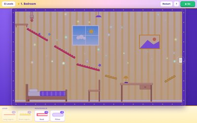
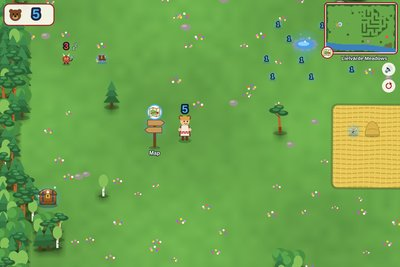
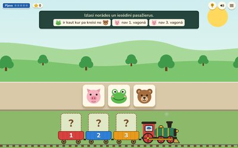
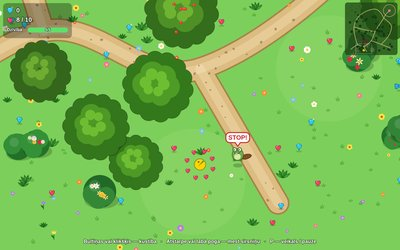
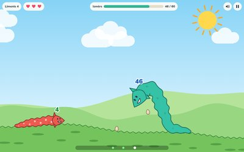

# Games

Small client-only browser games. Each one is its own repo, linked here as a submodule.

| | Game | Description |
|---|---|---|
|  | [balltrack](https://github.com/atiselsts/balltrack) | Build a path from everyday items to roll a bouncy ball into a light switch |
|  | [bearslayer](https://github.com/atiselsts/bearslayer) | Lāčplēsis: top-view game set in Latvia, travelling a map of Latvia and beating monsters and bosses |
|  | [choo-choo-train](https://github.com/atiselsts/choo-choo-train) | Logic puzzles solved by matching items to train carriages |
|  | [heart_ball](https://github.com/atiselsts/heart_ball) | Sirsiņbumba: top-view game about collecting hearts and fighting a flower boss |
|  | [snake-amoeba](https://github.com/atiselsts/snake-amoeba) | Čūskamēba: side-view snake game about eating and growing |

Clone with the submodules:

    git clone --recurse-submodules https://github.com/atiselsts/simple-games.git

To get the latest version of every game:

    git submodule update --remote
